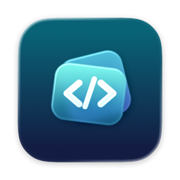
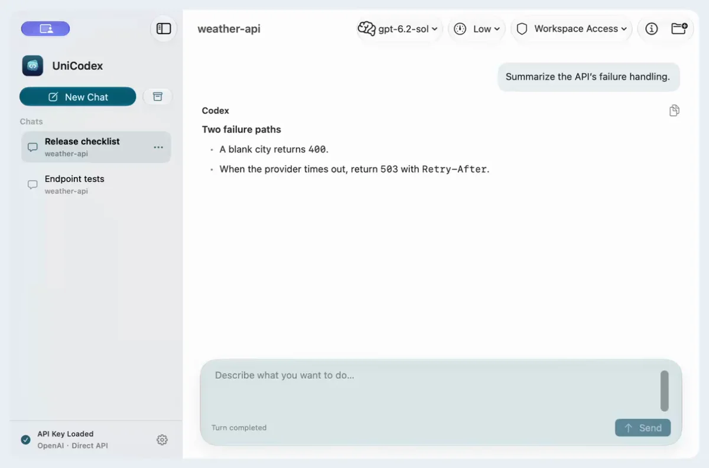

  

<h1 align="center">UniCodex</h1>

A native macOS workbench for coding agents built on the Codex engine.

  <a href="README.zh-CN.md">简体中文</a> ·
  <a href="#build-and-install">Build and install</a> ·
  <a href="#local-mcp">Local MCP</a>

UniCodex runs Codex coding sessions in the local folders you choose. Bring your own API keys, run several chats at once, and choose the provider, model, and reasoning level for each turn. Model calls go to the selected provider and use that provider’s API billing.

## Demo

  

Continue the same chat with another provider and turn the previous answer into a release checklist. The recording uses sample data. [Still image](docs/unicodex-demo-still.webp)

## What you can do

- **Work in parallel.** Open multiple chats, let tasks run independently, and rename or archive work as you go.
- **Switch models mid-conversation.** Pick a provider, model, and supported reasoning level for the next turn. Cross-provider continuations carry recent conversation context into the new engine.
- **Work with long transcripts.** Read native Markdown, collapse tool output and reasoning summaries, and open local file links or reveal them in Finder.
- **Delegate from another agent.** Send tasks over local MCP and follow their status by task ID.
- **Use a native macOS interface.** SwiftUI and AppKit provide the window, menus, and transcript. Liquid Glass is available on macOS 26 and later. The interface supports English, Simplified Chinese, Japanese, Korean, German, French, and Russian.

## Build and install

You need macOS 14 or later, Xcode 26 or later selected as the active developer directory, and Python 3.11 or later. The build targets the Mac’s current architecture.

~~~sh
git clone https://github.com/wybaby168/UniCodex.git
cd UniCodex
./build.sh
~~~

This installs `/Applications/UniCodex.app`. The first build creates a local signing identity. Later builds reuse the credential helper when its source is unchanged so provider keys remain accessible across app updates. To compile a signed bundle in the checkout instead, run `./build.sh --build-only`. The bundle appears at `build/UniCodex.app`.

### First run

1. Open UniCodex. It uses its managed Codex engine or the engine bundled with ChatGPT in Applications. If the engine is missing, use **Preferences → Engine → Check for Updates** and reopen UniCodex after the update is verified.
2. Open **Preferences → Providers** from the sidebar gear or with **⌘,**. Select a provider profile and save its API key. For a new OpenAI key, add an OpenAI profile with **+**.
3. Choose a working folder and a model in the chat toolbar, then send a task. Open **Appearance** to choose the app language and accent color.

| Provider | Profile |
| --- | --- |
| OpenAI | Add an OpenAI profile with an API key |
| DeepSeek | Configure the built-in DeepSeek profile |
| Kimi Code | Configure the built-in profile and choose the service region |
| Google Gemini | Configure the built-in Gemini profile |
| Custom | Supply an HTTPS base URL that supports the Responses API and the model IDs to expose |

New provider keys are stored in the local macOS Keychain. UniCodex uses an application-specific directory for its engine, workspaces, and session state.

## Local MCP

Open **Preferences → Agent** to copy the stdio server configuration. To register it in Codex, run the following command.

~~~sh
codex mcp add codex_api_workbench -- /Applications/UniCodex.app/Contents/MacOS/APIWorkbench --mcp
~~~

| Tool | Purpose |
| --- | --- |
| `list_models` | List configured providers and models. Pass a provider ID to see supported reasoning levels. |
| `dispatch_task` | Start a task with an optional absolute workspace path, provider, model, and reasoning level. Reuse a `request_id` with the same input when retrying. |
| `task_status` | Check progress or wait up to 20 seconds for a status change. Retrieve the answer when the task finishes. |
| `cancel_task` | Stop a task started through MCP. |

For example, an MCP client can pass these arguments to `dispatch_task` after confirming the model with `list_models`.

~~~json
{
  "prompt": "Read this project and summarize its entry points.",
  "workspace": "/path/to/project",
  "provider": "deepseek-default",
  "model": "deepseek-flash",
  "effort": "high",
  "request_id": "inspect-project-001"
}
~~~

Call `task_status` with the returned `task_id`. Approvals requested during a task appear in UniCodex. The MCP connection runs locally under the current macOS user.

## Develop and verify

- [Sources/UniCodex](Sources/UniCodex) contains the app, transcript renderer, provider adapters, and MCP server.
- [Sources/Credentials](Sources/Credentials) contains the signed credential helper.
- [Resources/Localization](Resources/Localization) contains one native string bundle per interface language.
- [Tests](Tests) contains a local fixture that drives the real Codex app-server without provider API calls.

~~~sh
xcrun swift-format lint --strict --recursive Sources/UniCodex Tests
python3 Tests/offline_check.py
~~~

The offline check uses the Codex engine bundled with ChatGPT in Applications by default. Set `WORKBENCH_TEST_CODEX_BINARY` to the path of another compatible Codex executable to test that engine. The test uses temporary workspaces and synthetic credentials.

## License

The UniCodex source is available under the [MIT License](LICENSE). The bundled Codex model metadata carries its upstream [Apache 2.0 license](Resources/CodexCatalog-LICENSE.txt). See [third-party notices](THIRD_PARTY_NOTICES.md) for provenance and attribution.

UniCodex is an independent project built on [OpenAI Codex](https://github.com/openai/codex).
