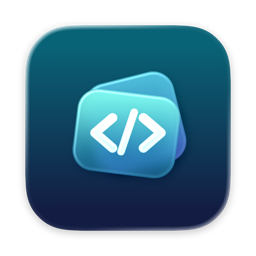
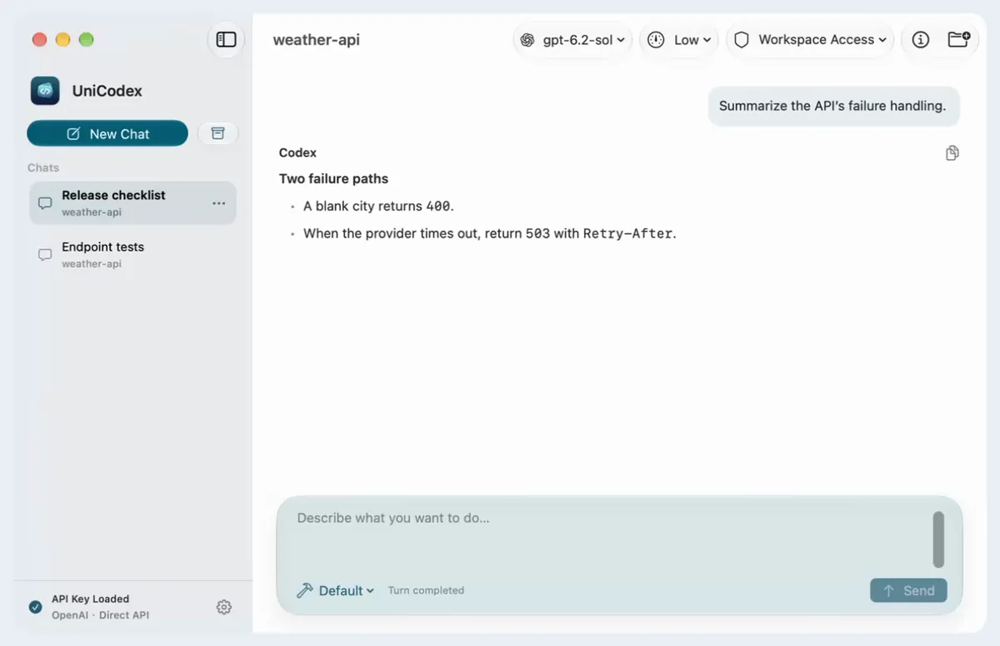

  

<h1 align="center">UniCodex</h1>

基于 Codex 引擎的原生 macOS 编程工作台

<a href="README.md">English</a>

在指定的本机项目目录中运行 Codex，使用自己的 API Key，按会话和任务选择供应商、模型与推理强度。模型请求由所选供应商处理并按其 API 规则计费。

## 操作演示

  

在同一会话切换供应商，将上一轮的回答整理成发布清单。以本机 UniCodex 1.11.5 录制，使用演示数据。[静态截图](docs/unicodex-demo-still-v1.11.5.webp)

## 主要功能

- **多会话并行**。多个任务可独立运行，会话支持重命名和归档。
- **计划和执行**。在输入框下方选择引擎支持的协作模式。在计划模式里回答澄清问题并查看拟定计划，点「执行计划」即可在同一会话切回默认模式接着做。
- **会话中切换模型**。可在下一轮更换供应商、模型和推理档位，跨供应商接续时带入最近对话。
- **长对话阅读**。Markdown 支持跨段拖选，进度消息和结论可一键复制。可折叠思考摘要和工具详情，也可打开本地文件链接或在 Finder 中显示。
- **本机 MCP**。其他 Agent 可以派发任务、查询结果和取消任务。
- **原生 macOS 界面**。基于 SwiftUI 和 AppKit，在 macOS 26 及以上使用系统液态玻璃效果。支持简体中文、英语、日语、韩语、德语、法语和俄语。

## 安装

通用 ZIP 支持运行 macOS 14 或以上版本的 Apple 芯片和 Intel Mac。解压后将 **UniCodex.app** 移到「应用程序」。[下载 UniCodex](https://github.com/wybaby168/UniCodex/releases/latest)

v1.11.7 安装包使用维护者证书签名，尚未通过 Apple 公证。下载后首次启动可能被 Gatekeeper 拦截。也可以从源码在本机构建。

### 从源码构建

需要 macOS 14 或以上、Xcode 26 或以上，以及 Python 3.11 或以上。请先选中完整的 Xcode 开发目录。

~~~sh
git clone https://github.com/wybaby168/UniCodex.git
cd UniCodex
./build.sh
~~~

应用会安装到 `/Applications/UniCodex.app`。首次构建会创建本机签名身份，后续构建复用签名和未改变的密钥读取组件。只构建供检查时，可使用 `./build.sh --build-only`，产物在 `build/UniCodex.app`。

1. 打开 UniCodex。应用可使用独立管理的 Codex 引擎，也可使用「应用程序」中 ChatGPT 附带的引擎。缺少引擎时，在「偏好设置 → 更新 → Codex 引擎」检查更新，校验完成后重新打开应用。
2. 通过左下角齿轮或 **⌘,** 打开「偏好设置 → 供应商」。可配置 OpenAI、DeepSeek、Kimi Code、Google Gemini，也可添加支持 Responses API 的自定义 HTTPS 端点。首次使用 OpenAI 密钥时，通过 **+** 添加 OpenAI 配置。
3. 在聊天工具栏选择工作目录、模型和推理强度，然后发送任务。界面语言和主题色可在「偏好设置 → 外观」更改。

新配置的 API Key 保存在本机 macOS 钥匙串。

## 更新

启动时，UniCodex 会检查 [GitHub Releases](https://github.com/wybaby168/UniCodex/releases) 上的稳定版。「偏好设置 → 更新」显示已安装版本，也可以手动检查。适用于当前 Mac 的安装包会通过浏览器下载，下载完成后手动安装。

Codex 引擎在启动时和每隔 24 小时检查稳定版本。优先使用 OpenAI CDN，失败时自动尝试官方 GitHub Release 和 npm 分发。新版通过校验和、macOS 代码签名与 app-server 兼容性检查后，在下次启动时启用。每次检查会清理已停用的独立引擎和遗留下载文件。正在运行的会话继续使用当前引擎。

运行 `./build.sh --release` 可在 `build/` 生成本地签名的 `UniCodex-macos-universal.zip` 和 `SHA256SUMS`。申请 Apple 公证时，使用 Developer ID Application 证书、强化运行时和安全时间戳签名。将票据附加到 DMG，或在打包 ZIP 前附加到应用。应用可识别 `UniCodex-macos-arm64`、`UniCodex-macos-x86_64` 和 `UniCodex-macos-universal` 的 `.dmg` 或 `.zip` 附件。[Apple 公证指南](https://developer.apple.com/documentation/security/notarizing-macos-software-before-distribution)

## 本机 MCP

在「偏好设置 → Agent」可以复制 MCP 配置。在 Codex 中可运行以下命令完成注册。

~~~sh
codex mcp add codex_api_workbench -- /Applications/UniCodex.app/Contents/MacOS/APIWorkbench --mcp
~~~

先用 `list_models` 确认模型、推理档位和协作模式，再通过 `dispatch_task` 派发任务。传入 `"mode": "plan"` 可请求计划。用返回的 `task_id` 调用 `task_status` 等待结果，或用 `cancel_task` 取消。若状态为 `waiting_input`，在 UniCodex 对应会话中回答。审批也在会话内处理。完整参数示例见[英文文档](README.md#local-mcp)。

## 开发和许可

~~~sh
xcrun swift-format lint --strict --recursive Sources/UniCodex Tests
python3 Tests/offline_check.py
~~~

离线检查使用真实 Codex 引擎和本机模拟服务。可设置 `WORKBENCH_TEST_CODEX_BINARY` 指定另一个兼容的引擎。

UniCodex 源码采用 [MIT 许可证](LICENSE)。内置的 Codex 模型元数据沿用上游的 [Apache 2.0 许可证](Resources/CodexCatalog-LICENSE.txt)。[第三方来源与许可](THIRD_PARTY_NOTICES.md)

UniCodex 是基于 [OpenAI Codex](https://github.com/openai/codex) 开发的独立项目。
